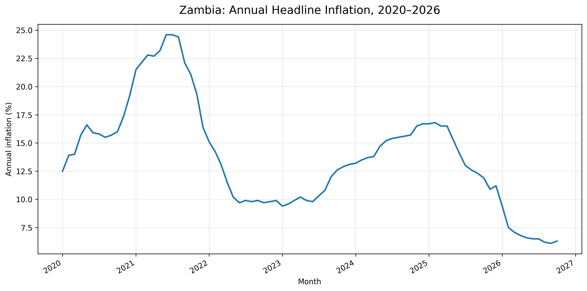
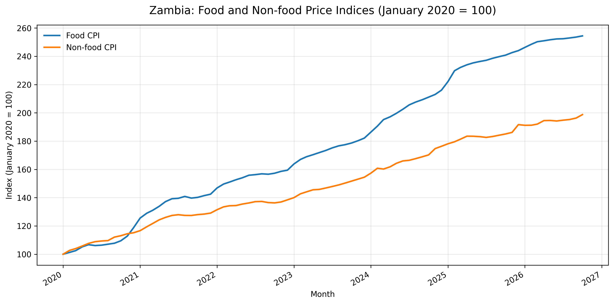
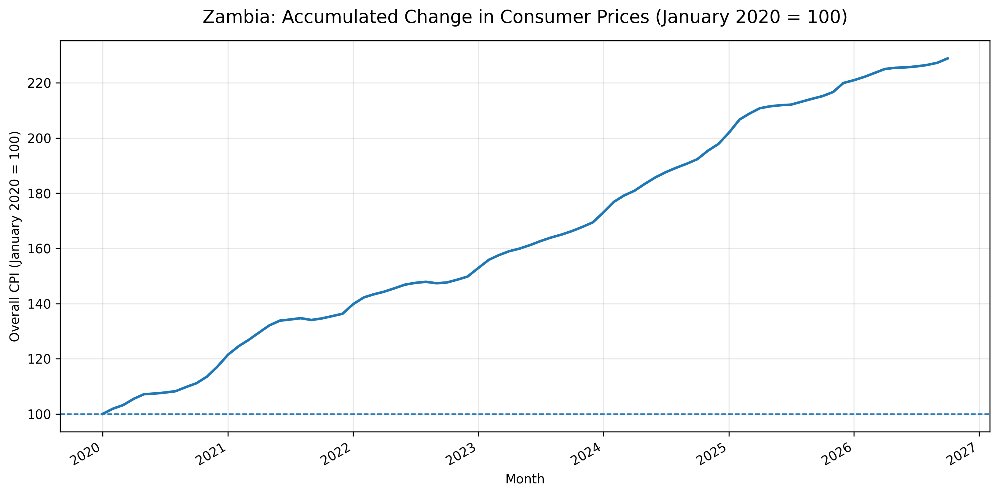

# Inflation and the Cost of Living in Zambia (2020–2026)

**Independent economic research by Canan Phiri**  
**Research period:** January 2020 – October 2026  
**Location:** Zambia

## Overview
This project examines Zambia's inflation and cost-of-living experience between January 2020 and October 2026. It considers changes in the overall Consumer Price Index (CPI), food and non-food prices, exchange-rate movements, and selected household cost-of-living indicators.

The central question is: **when inflation falls, does that mean the cost of living has fallen too?** The analysis distinguishes the rate at which prices change from the accumulated level of prices faced by households.

## Repository contents
- `research/` — current working-paper draft.
- `data/processed/` — monthly CPI dataset used in the analysis.
- `references/` — source documentation and links.
- `analysis/` and `figures/` — reserved for reproducible analysis scripts/notebooks and publication-quality figures as these are added.

## Selected figures

The following figures are generated from the monthly CPI dataset in `data/processed/`.

### 1. Annual headline inflation

### 2. Food and non-food price indices

### 3. Accumulated change in consumer prices

## Data and sources
The CPI dataset was compiled from publications of the Zambia Statistics Agency (ZamStats):
1. *The Monthly*, Volume 256, July 2024, Annex 1, Tables 1.1 and 1.3.
2. *The Monthly*, Volume 283, October 2026, Annex 1, Tables 1.1 and 1.3.

Other sources discussed in the working paper include the Bank of Zambia and the Jesuit Centre for Theological Reflection (JCTR). See [`references/sources.md`](references/sources.md).

## Method and limitations
The analysis is descriptive and exploratory. CPI component inflation rates and rebased indices are calculated from monthly CPI observations. The available exchange-rate series and selected JCTR basket observations cover shorter periods and are not treated as complete monthly series. The project does not claim to identify causal effects or estimate a formal exchange-rate pass-through model.

The dataset contains source and verification fields. Consult the original statistical publications before reusing figures in consequential analysis or publication.

## Status
This is an independent research project and a working paper. It is not presented as a peer-reviewed publication. The manuscript and analysis may be revised as data checks and editorial feedback are completed.

## Author
**Canan Phiri** is a Zambian mathematics educator and independent researcher with interests in applied mathematics, quantitative finance, economic analysis and data-driven research. He holds a BSc in Mathematics Education from Copperbelt University and an MEd in Mathematics Education from the University of Zambia. He is currently pursuing postgraduate studies in Financial Engineering at WorldQuant University and Mathematical Sciences at the African Institute for Mathematical Sciences (AIMS), Ghana.

## Suggested citation
Phiri, C. (2026). *Inflation and the cost of living in Zambia (2020–2026): An analysis of food prices, exchange rate dynamics and household purchasing power* [Working paper].

## Contact
For research-related enquiries, please use the contact details on the author's GitHub profile.
